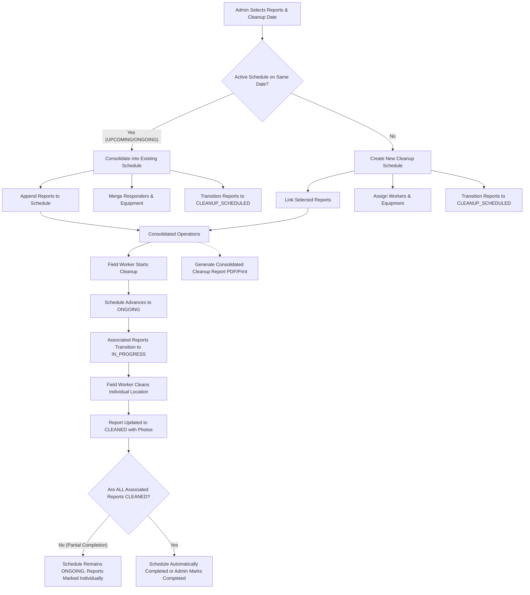

# Automatic Waste Report Consolidation for Cleanup Scheduling

## Overview
In the BlueWaste Management System for Panabo City, multiple coastal waste reports can be submitted by various citizens across different barangays and coastal zones. Prior to this feature, cleanup schedules could be created for the same date independently, potentially fragmenting operations, duplicating logistics, and splitting cleanup documentation.

The **Automatic Cleanup Schedule Consolidation** feature intelligently consolidates multiple waste reports scheduled for the same cleanup date into a single, unified cleanup schedule and combined cleanup report, while strictly preserving original citizen submissions, locations, classifications, and audit logs.

---

## 1. Database Architecture & Relationships

### Why the Existing Schema Was Preserved
Inspection of the existing Prisma schema revealed that the relationship between `CleanupSchedule` and `Report` is already properly modeled as a **1-to-many relationship**:

```prisma
model CleanupSchedule {
  id              String            @id @default(uuid())
  title           String
  description     String?
  scheduledAt     DateTime
  estimatedHours  Float?
  actualHours     Float?
  status          ScheduleStatus    @default(UPCOMING)
  equipment       String[]
  reports         Report[]          // One schedule groups many reports
  assignedWorkers ScheduleWorker[]
  // ...
}

model Report {
  id                String            @id @default(uuid())
  trackingNumber    String            @unique
  category          WasteCategory
  severity          WasteSeverity     @default(LOW)
  status            ReportStatus      @default(PENDING)
  latitude          Float
  longitude         Float
  address           String
  images            String[]
  reporterId        String?
  reporter          User?             @relation(fields: [reporterId], references: [id])
  cleanupScheduleId String?           // Foreign key referencing CleanupSchedule
  cleanupSchedule   CleanupSchedule?  @relation(fields: [cleanupScheduleId], references: [id])
  statusHistory     StatusHistory[]
  // ...
}
```

### Architectural Benefits:
1. **Preservation of Submission Integrity:** No citizen submission is merged, overwritten, or destroyed. Every `Report` retains its unique `id`, `trackingNumber`, citizen ownership (`reporterId`), geolocation (`latitude`, `longitude`, `address`), AI/classification metadata, and verification history.
2. **Backward Compatibility:** All existing schedules and reports function seamlessly without requiring breaking schema migrations or redundant many-to-many junction tables.
3. **Audit Trail:** Status changes append to each report's `StatusHistory`, tracking transitions with timestamps and actor IDs.

---

## 2. Scheduling & Consolidation Workflow



### Key Business Rules:
- **Same-Calendar-Day Grouping:** Compares dates across UTC and Panabo local time bounds to detect active schedules on the target calendar day.
- **Append & Merge:** When adding reports to an existing schedule, workers and equipment lists are deduplicated and merged.
- **Duplicate Prevention:** Reports already assigned to a different active schedule or already `CLEANED` / `REJECTED` are rejected before mutations occur.
- **Atomic Transactions:** Backend operations use `prisma.$transaction` ensuring schedule updates, report linking, and status history logs commit atomically.

---

## 3. Status Management & Partial Completion Logic

Status lifecycle transitions adhere to the strict rules of coastal waste management:
- `PENDING` / `VERIFIED` &rarr; `CLEANUP_SCHEDULED`: When included in a schedule.
- `CLEANUP_SCHEDULED` &rarr; `IN_PROGRESS`: When cleanup commences (or schedule transitions to `ONGOING`).
- `IN_PROGRESS` &rarr; `CLEANED`: When an individual report location is inspected and completed by field workers.
- **Partial Cleanup Protection:** The consolidated schedule cannot be marked as `COMPLETED` if any linked location remains `CLEANUP_SCHEDULED` or `IN_PROGRESS`. Both the backend validation (`ScheduleService.updateStatus`) and the frontend UI block premature completion.
- **Automatic Completion:** Once every associated report achieves `CLEANED`, `ScheduleService.syncScheduleStatus` automatically marks the schedule as `COMPLETED`.

---

## 4. Consolidated Cleanup Report Generation

The backend exposes `GET /api/v1/schedules/:id/report`, authorized for `LGU_ADMIN` and `FIELD_WORKER`. It returns:
- **Schedule Identification:** Unique schedule ID, title, date, estimated hours, and overall schedule status.
- **Summary Metrics:**
  - Total grouped reports (`totalReports`).
  - Total distinct reporting citizens (`totalCitizens`).
  - Progress counters (`cleanedReportsCount`, `inProgressReportsCount`, `scheduledReportsCount`).
  - Flag indicating whether all locations are fully cleaned (`isFullyCleaned`).
- **Responders & Logistics:** Assigned field workers (names, phone numbers, emails, lead worker) and equipment list.
- **Grouped Reports Collection:**
  - Original report ID, tracking number, and creation date.
  - Citizen attribution (name, email, or "Anonymous Citizen").
  - Waste category, severity, and AI waste count (if available).
  - Exact coordinates (`latitude`, `longitude`) and full address.
  - Image attachments and report status.
- **Completion Verification:** Completed timestamp and supervisor notes when finished.

The frontend modal (`ConsolidatedReportModal.tsx`) renders this into an official City Environment and Natural Resources Office (CENRO) Panabo format ready for print or PDF export.

---

## 5. UI Enhancements

1. **Admin Scheduling Interface (`ScheduleForm.tsx` & `ScheduleList.tsx`):**
   - Live date listener alerts admin with an "Auto-Consolidation Active" badge if a schedule already exists on the selected date.
   - Live badge shows `Consolidated (X reports across Y citizens)` when selecting multiple reports.
   - Schedule table and cards display `Consolidated (X)` badges.

2. **Schedule Details View (`ScheduleDetail.tsx`):**
   - "Consolidated Activity" banner with report count and citizen count.
   - Direct button to open and print the **Combined Cleanup Report**.
   - Displays all associated reports with address, GPS coordinates, status, and direct "Inspect Location" link for field workers.
   - Disables "Mark as Completed" with a warning tooltip when locations are still pending.

3. **Field Worker Dashboard (`/field-worker`):**
   - Presents consolidated schedules as single assignments with nested location cards.
   - Visual progress bar showing `X of Y locations completed`.
   - Allows independent inspection of each location without falsely marking entire schedules as cleaned.

---

## 6. Test Suite

Located at `backend/tests/integration/schedule-consolidation.test.ts`:
- **Test 1:** Successfully consolidates multiple reports from different citizens into one schedule.
- **Test 2:** Appends newly scheduled reports to an existing same-day schedule without creating duplicates.
- **Test 3:** Merges assigned workers and equipment without duplication.
- **Test 4:** Prevents duplicate report assignments when report is already scheduled.
- **Test 5:** Rejects reports with invalid status (`CLEANED` or `REJECTED`).
- **Test 6:** Transitions associated reports to `IN_PROGRESS` when schedule starts.
- **Test 7:** Prevents completing schedule if any linked location is uncleaned.
- **Test 8:** Allows completing schedule when all linked reports are `CLEANED`.
- **Test 9:** Syncs schedule to `ONGOING` when any report starts cleanup.
- **Test 10:** Automatically marks schedule `COMPLETED` when all reports reach `CLEANED`.
- **Test 11:** Generates complete consolidated report data with accurate metrics.

